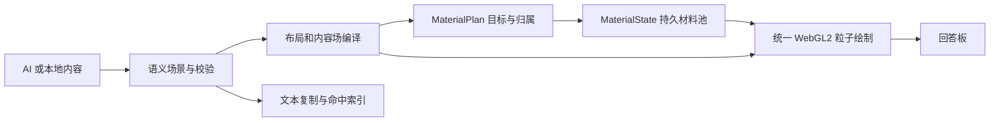

# Forma 1.0：统一材料显示架构

2026-10-09 修订。本文件描述当前实现的显示基线；`PROJECT.md` 中更广的产品路线不等同于已实现能力。

Forma 是可接不同 AI 的独立回答板。AI 给出内容与关系，本地编译器负责布局、材料分配和逐帧显示。屏幕像素是输出采样格点；不需要接管操作系统的屏幕，也不需要 AI 逐帧生成像素坐标。

## 这次修正的根因

旧实现把中央液团、连接形状和答案格点分别计算，再用展开进度拼在一起。它能产生动画，却没有保证同一份材料从中央移动到内容位置，所以会出现固定黑团、整图展开和末帧换形。这是状态与归属设计的问题，不能靠针对某张图片调参数解决。

现在中央液体、流动表面和附着内容共同读取持久材料状态。不存在独立的黑团或液桥绘制程序；时间到达终点也不跳过材料绑定。海岸图、文字、图表和视频都是这条通用管线的输入。

## 不可变条件

1. 同一画板中的材料 ID 持续存在。等待、流动、附着是同一份材料的状态；数量之和始终等于池容量。
2. 中央液团只来自当前位于中央的材料。材料离开后，中心自然变空；若内容本身位于中央，则显示真实内容。
3. 内容格点必须绑定材料。最终位置、颜色混合和覆盖率仍读取绑定，不能在动画结束时直接跳到原图显示。
4. 改变材料状态必须改变画面，包括已经驻留的内容。移走全部流动材料后，液面贡献必须完全消失。
5. 后续回答继承当前材料位置、速度和颜料。只有明确进入新的空白待机板时才重新聚集。
6. 文字、图表、图片和视频共用编译、分配与绘制机制，不根据测试素材的文件名选择算法。
7. 回答区域的内容、交互标记和控件均由 `gl.POINTS` 绘制。离屏图像、字形画布与解码视频只提供颜色和覆盖率；不成为可见 DOM、SVG 或视频叠层。

这里的数量守恒是材料身份与分配守恒。1.0 没有实现不可压缩流体的体积、动量或能量守恒，不能把简化运动称为完整流体物理。

## 模块与权威数据

| 模块 | 权威数据与职责 | 实现 |
| --- | --- | --- |
| 语义和布局编译 | 正文、数据、媒体引用、布局、命中；生成离屏颜色/覆盖率场 | `app/compiler.js`、`app/scene-validation.js` |
| 材料分配计划 | 源场分块、内容局部坐标、材料归属、动态目标 | `app/material-plan.js` |
| 材料状态 | 持续的 ID、位置、速度、目标、颜料、附着程度 | `app/material-state.js` |
| 取样与绘制 | 上传状态、重建液面、绘制绑定的内容格点、合成层级 | `app/particle-renderer.js`、`app/liquid-shaders.js` |
| 模型网关 | 请求、取消、提供方协议归一；不决定粒子运动 | `server.mjs`、`server/provider.mjs` |

这些是编译器及其内部运行模块的职责划分，没有另起一个通用引擎项目。模型接口与输入协议不因这次显示修正而改变。

## 材料和显示格点不是同一个预算

画板按初始有效像素面积分配 4096–12288 份带权材料，保存为连续数组。最终显示格点根据实际画布像素密度取样；一个材料可以支撑多个格点。这样清晰文字和图片仍可达到像素级采样，而不必为数百万个硬件像素逐个做物理积分。

编译后的内容分成有界小块，通过空间顺序将相近材料分配给相近目标。空间排序只是近似传输，不声称是全局最优输运。透明区域也保留邻近材料归属，供以后的视频帧或内容更新使用。

显示格点从邻近最多四份材料重建位移、覆盖率和颜料，降低分块边界的断裂。只有具备附着覆盖率的材料参与精细成像，尚未到达的邻居不能将其拖到空中。格点依然支持单独移动和改色。材料 ID、内容字段 ID、格点 ID 分别用于运动、语义归属和精确采样，不能混为同一概念。

尺寸变化保留当前材料池和 ID，更新坐标及布局；显示取样密度独立调整。新建画板时重新按设备预算分配。此策略优先保持正在显示的材料连续，不承诺跨设备永久保存微粒身份。

## 从待机到附着

- 待机：同一批材料聚集在中心，局部形变形成黑色液面。
- 分配：内容场决定目标；保留当前的位置、速度和颜料，新增目标归属。
- 流动：按材料在团内的深度错开发出，以固定 1/120 秒时间步积分；弯曲导向、临界阻尼和局部速度耦合共同控制运动。
- 染色：从已有颜料向新目标颜料连续变化，颜色在途中已经变化。
- 附着：距离目标约 3 CSS px 内开始解析精细覆盖率；距离和速度均足够小时，精确归位并归零速度。
- 驻留：显示继续读取同一归属与状态。没有以 `progress == 1` 为条件的原图显示分支。

默认初次展开时间尺度为 2.6 秒。绘制是否继续取决于材料是否稳定，而非计时结束强制换图。减少运动通过直接提交同一材料的目标状态实现。

液面由材料密度与颜料重建；精细内容由同一绑定的格点采样。两种取样方式属于同一输出管线，不是答案底图加一层遮罩。重建半径、高光和黏连是可调的视觉近似，与状态连续性分别验收。

## 持续显示与更新

| 变化 | 更新内容 | 保留内容 |
| --- | --- | --- |
| 动画平移/旋转 | 局部目标的世界坐标 | 材料 ID、源场归属 |
| 视频换帧/seek | 源场颜色、覆盖率和材料颜料 | 归属纹理、材料池 |
| 滚动 | 视口坐标与可见性 | 全文的材料分配；不因进入/离开视口重分配 |
| 宽度变化/文字重排 | 布局和目标计划 | 材料池；重建目标绑定 |
| 新回答/替换场景 | 新目标、语义与内容场 | 当时材料的位置、速度、颜料 |
| 选择、悬浮与控件 | 驻留交互格点 | 内容语义与原始数据 |

主面板与验收页直接使用同一个 `ParticleCompiler` 和渲染模块。验收页只控制时钟、注入测试输入和读取结果，没有私有液体实现。

交互标记和固定控件采用解析驻留格点，不参与回答材料的液态运输；仍统一由粒子绘制并支持整体清空。视频解码由浏览器承担，解码元素不连接可见 DOM。

## 验证面向架构约束

状态测试检查数量守恒、材料连续、途中染色、30/60/120 Hz 固定步一致性、重定向和尺寸变化。计划测试检查稀疏文字覆盖、目标更新、透明区域绑定和视频换色。

浏览器验收读取真实 GPU 像素，并主动注入故障：

- 移走全部材料后液面必须为空，检测独立黑团和附加液桥。
- 100% 后只改 GPU 材料位置，内容必须跟着移动，检测终点绕过。
- 到位前后画面一致，不能靠最后一帧换图。
- 视频新帧在原先透明区域也能显示，且归属不变。
- 文字、图表、动画、图片和媒体统一停用后整板清空。
- 非法输入保留原画面，长中文重排不丢字，资源销毁完整。

GPU 通过只能证明这些约束在受测浏览器成立，不能替代对液体观感、可读性和真实设备性能的判断。海岸图用于暴露连续性与细节还原问题，不是单独优化的目标。

## 当前边界

已实现 WebGL2 与 CPU 固定步材料积分；没有完整流体求解器、WebGPU 计算后端或跨设备性能保证。材料分配是一次布局范围的近似分配；完整增量场景事务、跨回答稳定语义块匹配和局部重编译仍属后续能力。模型适配器只经过本机假上游验证，尚未使用真实 API Key 做在线联调。

更真实的黏性、表面张力和断裂可以在同一状态模型上改进。它们不能重新引入独立背景液团、预绘制答案底图或终点替换。
