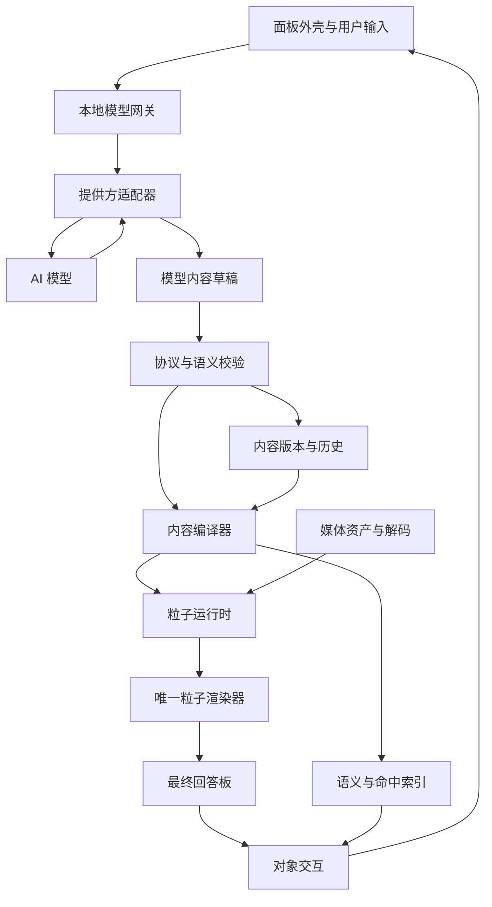

# 流形 · Forma 项目设计

流形是一款连接不同 AI 的独立回答面板。用户提出问题，AI 描述内容与关系，粒子编译器把这些描述变成可寻址粒子的状态，并通过内部轻量运行模块持续组成最终画面。粒子落板就是内容，不再交接给其他显示层。中文名称「流形」、英文名称「Forma」，品牌文案沿用「让思想，自然成形」。

> **当前状态：已进入本地 1.0 实现。** 启动与实际功能见 [README.md](README.md) 和 [docs/V1.md](docs/V1.md)。代码采用独立面板、含 WebGL2 运行模块的粒子编译器、本地模型网关；不另建通用引擎项目。两类模型接口已通过本机假上游测试，尚未使用真实 API Key 联调。历史为 localStorage 快照，媒体仅当前页面会话可用；当前协议执行范围以 `app/scene-validation.js` 为准。

**显示架构已整体修正（2026-10-09）：** 当前权威基线见 [DESIGN.md](DESIGN.md)。材料池贯穿待机、流动与驻留；通用目标计划支持文字、图表和媒体；不存在独立黑团与终点换图。旧的液体连续性验收不能作为此架构的证明，当前材料故障注入与生命周期验收单独记录在 V1.md。

本文以下内容保留完整项目设计与后续路线，其中“粒子引擎”表示可单独验证的内部职责，不代表 1.0 必须拆出独立项目。完整分支、SQLite、WebGPU、媒体资产归档及其他设计能力不能视为已交付；浏览器与设备验收结果在 V1.md 单独记录。

## 产品范围

首个可用版本服务个人桌面用户，解决理解概念、比较数据和继续修改答案三类问题。使用本地启动的浏览器面板与本地网关，凭据由网关管理。默认保存到本机，不以注册云账号为前提。

第一可用版包含纯粒子文字与复制、柱状与折线图、有限参数动画、图片、登记格式的本地短片、对象追问、历史分支和两个不同提供方的模型接入。所有能力逐阶段验收后才标记可用。

付费图片或视频生成、移动端完整编辑、多人同步、模型执行任意代码、第三方插件市场、自动改造所有聊天软件不进入首版。短视频播放与短视频生成是两个独立能力；前者通过后再接后者。移动窄屏先保证阅读和基本输入，复杂编辑的正式支持后置。

首批固定用例为：用文字和示意动画解释月球运动；用用户提供的三年数据生成并修改图表；在同一板上播放本地短片并查看字幕。示意动画明确简化条件，图表保留原始数据与来源。

## 核心体验

应用由左侧会话列表、中央回答板、底部输入区和按需展开的设置组成。用户默认看见空白板与中央液态粒子。回答到来时，同一显示材料组成内容并驻留；阅读期间停止无意义的全屏运动。

追问围绕当前画面进行。用户可以选中文字、选中柱体或点击图形，输入“解释这里”“换成折线图”“把速度调慢”。已有表达切换与播放控制本地执行；需要新的解释或内容时才请求模型。

回答板内的菜单、数据表、引用、选区和播放控件由粒子显示。外部会话导航、模型配置和输入框可以使用原生 Web 控件。减少动态效果仅减少运动，最终显示仍由粒子完成。

历史按回答版本浏览。历史查看默认只读，从旧版本追问创建新分支，保留最新分支。切换模型会显示下一次请求的接收方，已有画面不重建、不自动发送历史。

详细屏幕、尺寸、视觉和交互规格见 [产品与体验](docs/PRODUCT.md)。

## 系统结构



渲染不能依赖某个模型的私有 UI 格式。输入协议、编译产物与 GPU 实现分层，模型适配器只负责请求、能力和结果归一。浏览器外壳不能绕过渲染器显示回答内容。

## 四个核心部分

| 部分 | 输入和输出 | 责任边界 |
| --- | --- | --- |
| 独立面板 | 用户意图、已显示版本、输入事件 | 会话、输入、选择与可访问性；不在 React 中重绘回答 |
| 内容编译器 | 合法语义场景到布局、内容源、图块绑定、命中和运动计划 | 确定性地计算“如何表达”；不调用模型或生成事实 |
| 粒子引擎 | 编译产物和局部控制到最终像素 | 粒子身份、驻留、释放、运动、取色、遮挡及合成 |
| 模型网关 | 用户请求、提供方配置到候选内容与版本事务 | 鉴权、协议转换、取消、资源登记、历史与成本 |

编译器是一组内容处理模块，无须先发明编程语言。JSON 是输入载体，语义场景是内部表示，字形与几何是编译中间产物，图块及粒子绑定是渲染输入。

粒子运行时采用驻留格点与稀疏运动状态。驻留单元的位置可由格点推导；正在流动的粒子另存位移和速度。透明重叠保留分层归属，不能先把全画面压成一张纹理后丢失对象身份。

## 权威状态和提交顺序

模型仅产生 ModelSceneDraft：内容、布局意图、数据与受限动作。requestId、branchId、revision 和资产权限由宿主决定。模型不得指定下一内容版本、GPU 句柄或本机文件路径。

每个分支快照保存有序回答列表，每个回答有独立草稿。普通追问追加回答，明确修改则替换目标回答的草稿并局部编译。本地网关是每个分支唯一的内容版本写入者。面板拥有当前已呈现版本、视图状态和 GPU 资源。持久化版本与已经显示的版本分别记录，不宣称数据库和 GPU 能进行一个物理原子提交。

一次更新经过草稿校验、差异分析、编译、面板准备确认、网关持久化提交、下一有效帧呈现。事件与操作必须带当前已显示版本和视图标识。提交后崩溃可从已持久化内容恢复；编译失败保留最后有效画面。

暂停播放、悬停、文字选择和缩放属于本地视图状态。修改图表数据产生内容版本；首版播放速率与重置属于视图控制，模型自定义的持久参数绑定后置。动画每帧、视频帧和窗口缩放都不生成模型回答版本。

## 技术决策

| 领域 | 首版决定 | 后续边界 |
| --- | --- | --- |
| 应用 | TypeScript，React 管理外壳，Vite 开发构建 | 桌面封装待引擎验收后选择 |
| 编译器 | 独立 TypeScript 包，字体整形可用 WASM | 与框架和提供方解耦 |
| 渲染 | WebGPU 与 WGSL，自建粒子绘制管线 | WebGL2 后端另行实现并通过同一验收 |
| 协议 | 项目内部 panel-scene/0.3 草案，JSON Schema 2020-12 | 对外发布前冻结版本与迁移规则 |
| 网关 | Node.js HTTP 服务，浏览器与 API 同源 | SDK 宿主可换 transport |
| 持久化 | 网关 SQLite 元数据与事务，资产文件按哈希存放 | 浏览器缓存是可丢弃的副本 |
| 媒体 | 有界帧队列，解码与绘制分离 | 生成服务独立额度与任务系统 |
| 质量 | 协议检查、固定场景、粒子可操作性和跨设备记录 | 不用旧 DOM 原型证明新引擎可用 |

选择 WebGPU 是因为它提供图形和计算能力；可用性在具体设备上探测，不把浏览器名称当成性能保证。[WebGPU 官方介绍](https://developer.chrome.com/docs/web-platform/webgpu/overview)

依赖精确版本、字体授权和打包策略在 M0 建仓时锁定。当前不写虚构 lockfile，也不把未创建的工程目录称为已实现模块。

## 模型和素材接入

首版适配器接口统一为 capabilities、generate、cancel 和 normalizeUsage。默认准备一个通用兼容接口适配器和一个不同协议的原生提供方适配器；发布验收必须使用两个独立提供方，不能用同一服务的两个别名替代。具体模型由用户配置，不内置会过时的固定型号或价格。

完整结构化草稿经验证后提交。纯文本模型由宿主包装为 text 节点，依然进入粒子编译。首次格式错误最多进行一次有界修复；修复与原请求共用预算。不能解析的数据不冒充可交互图表。

图片、视频与来源先登记为资产 ID，再被场景引用。模型不直接决定任意 URL 的下载权限。上传的本地素材默认仅用于本地显示；发送给外部模型时在请求入口明确显示附件与接收方。

后续生成媒体采用独立 jobId、额度和幂等键。渲染失败或打开历史不重新触发生成。媒体尚未就绪时保留占位、真实状态与取消入口。

## 工程目录和依赖方向

以下为计划中的实现结构，尚未创建的目录不代表可运行代码：

```text
apps/
  panel/                 外壳、路由、设置、输入、可访问性桥
  gateway/               提供方、资产、会话、事务、HTTP
packages/
  protocol/              Schema、类型、能力和错误码
  scene-store/           分支、版本与语义差异
  compiler/              文字、布局、图表、几何、内容源
  particle-core/         身份、图块、运动和调度
  renderer-webgpu/        WGSL、资源、粒子光栅化
  semantic-bridge/       命中、文本选择、键盘、辅助访问
  media/                 解复用、帧队列、时钟
  provider-adapters/     多 AI 归一接口
  sdk/                   宿主接入与生命周期
fixtures/                字体、固定场景、受控视频、故障样例
tests/                   单元、契约、浏览器与性能记录
```

依赖方向为 protocol → scene-store/compiler → particle-core → renderer；panel 组装这些模块，gateway 依赖 protocol 和 adapters。renderer 不导入 React、网络模型 SDK 或数据库。compiler 不访问提供方或自行下载资源。

当前实际设计文件与机器可校验样例见 [设计交付索引](README.md)。

## 存储与数据生命周期

SQLite 保存 sessions、branches、requests、scene_snapshots、commits、assets、jobs 和 usage_records。唯一键包含 branchId 与 revision、transactionId、requestId 与客户端幂等键；同一事务重放不能重复计费或产生新版本。

资产文件使用内容哈希去重，数据库保存 MIME、长度、来源、授权状态和引用关系。任何仍被历史引用的文件不能因清空渲染缓存被删除。删除会话解除引用，垃圾回收在明确的保留策略后移除无引用资产。

浏览器只缓存最近有效场景与必要资产。网关离线时可查看已缓存内容、播放已缓存媒体并保存输入草稿；联网请求和权威历史写入暂停，恢复后对齐版本。首版不做离线分支合并。

默认不上传遥测。诊断导出包含设备、运行时、场景规模、资源计数和错误码，默认排除提示词、原文、密钥与素材。用户可主动选择附带复现场景。

## 服务接口和任务取消

HTTP 采用同源接口。启动时仅监听本机回环地址，验证 Origin、会话令牌和请求体大小。自定义提供方端点由用户登记，不由模型输出；资产读取与本机网络权限分别管理。

关键接口包括创建会话、发起请求、接收事件、取消请求、提交本地内容操作、读取历史、登记资产、报告编译准备完成和报告呈现完成。完整字段与错误规则见 [协议规格](docs/PROTOCOL.md)。

请求事件使用有界逐行 JSON 流。浏览器用 fetch 响应流接收，保留跨网络 chunk 的 UTF-8 与半行状态；网络 chunk 不等于协议事件。取消通过独立接口作用于宿主请求，断开连接只停止订阅，重连读取已发生事件。[浏览器流式读取说明](https://developer.mozilla.org/en-US/docs/Web/API/Streams_API/Using_readable_streams)

同一分支首版串行接受内容提交。用户开始新追问时可以取消旧请求；已提交内容保留，尚未提交的候选丢弃。不同会话互不覆盖。多窗口对同一分支采用一个写入面板，其余只读，接管前完成租约交接。

## 开发顺序和交付定义

先验证粒子最终显示，再建立文字交互和版本系统，然后加入媒体，最后接入真实模型。模型调用很容易造成“看起来会回答”的错觉；只有离线固定场景已经满足核心约束，模型接入才有可验证的基础。

M0 固定内容与粒子诊断；M1 中文排版、选择复制与键盘；M2 图表、参数动画、局部编译和历史；M3 本地视频；M4 两个提供方和完整请求链；M5 可安装或可复现启动的个人试用版。具体任务与门槛见 [开发与验收](docs/DELIVERY.md)。

完成标准包含唯一显示路径、粒子身份可操作、内容与命中一致、失败恢复、媒体释放、提供方切换及设备记录。60 fps 和 30 fps 只是拟定测量目标；发布承诺必须附设备、分辨率、运动粒子数和内容规格。

## 关键取舍

首版限制任意布局、任意脚本与自由物理范围，以确保内容可读、可修改并可复现。选择轻量场景编译器而非开放代码执行，是为了让同一内容稳定适应不同设备，并能在不同模型之间保存语义。

粒子密度与运动预算分开；可见格点数量可以很高，同时自由运动的单元必须有界。透明层、全屏视频与小字号仍有真实成本，不能仅凭“使用 GPU”认定性能问题已解决。

新引擎通过门槛后再确定正式工期和商业包装。初期优先验证用户能否完成理解、比较与局部修改任务；API 与媒体成本记录实际消耗，产品定价与云托管后置。
