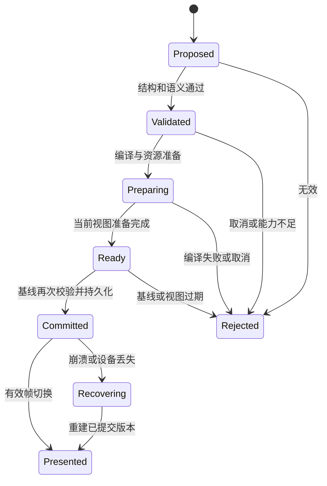

# 流形场景与宿主协议

panel-scene/0.3 是本项目的内部设计草案，替代 DESIGN.md 中早期 0.2 示意。它区分模型内容、宿主事务和编译结果。当前可校验文件仅覆盖模型草稿与宿主事务的结构及部分语义；网络服务、版本协调和渲染尚未实现。

## 内容单位和身份

一个会话包含多个分支；一个分支是一串内容版本，每个版本拥有有序回答列表。每个回答拥有独立 ModelSceneDraft。普通追问追加回答；明确修改选中内容时替换对应回答的完整草稿，编译器再按节点差异局部更新。模型不需重发整个聊天历史。

模型的 id 是单个回答内的逻辑键。宿主映射 answerId 与逻辑键到真实 nodeId，并维持跨修改的身份。同一逻辑键改变类型时拒绝，要求用新键表达新对象。请求可修改的 answerId 和节点范围由宿主指定，模型不能扩大范围。

sessionId、branchId、answerId、requestId、transactionId、权威版本、资产权限及 GPU 资源均不由模型填写。Schema 不接受这些额外顶层字段。

## 模型草稿

机器规格位于 specs/scene-draft.schema.json，采用 JSON Schema Draft 2020-12。Schema 负责字段和类型，语义检查负责引用、图关系与数据含义；二者不能互相替代。[JSON Schema 2020-12](https://json-schema.org/draft/2020-12)

草稿顶层为 protocol、summary、nodes、datasets、animations、actions。前三者必有内容，后面数组可以为空。未知字段拒绝；首版不接受 HTML、CSS、JavaScript、WGSL、远程脚本或逐粒子坐标。

| 节点 | 关键字段 | 布局或显示规则 |
| --- | --- | --- |
| group | direction、gap、可选 viewBox | column、row 或 free；子项由 parentId 关联 |
| text | text、role | 原文保留；角色为 title、body、caption、code |
| chart | datasetId、chartType、xField、yField、label、unit | 首版单系列 bar 与 line，数据不嵌进绘图代码 |
| shape | shape、material、label | circle、rect、line，固定图形区中的基本几何 |
| image | assetId、alt、fit | 引用已登记图片，不自行下载 |
| video | assetId、label、fit、可选字幕与封面 | 引用媒体管线，默认静音且不自动播放 |

每个节点有 id、parentId、layout；sourceRefs 可引用宿主登记来源。节点数组同时确定兄弟顺序。最高层必须 flow。absolute 节点只允许作为 free group 的直接子项，坐标在父 viewBox 内解释；free 必须提供 viewBox。circle 要求方形边界，line 从局部左上到右下，复杂路径后续扩展。

flow 缺省 width=fill、height=auto。group 缺省 gap=16；图表与媒体的自动高度由产品布局规则给出。bar 缺省包含零基线；若数据有负值零线置于相应位置。line 缺省自动范围并标注刻度。显式指定 bar 的 zeroBaseline=false 在首版拒绝。

主题只接受语义材质角色。回答背景、文字笔画、图表标记与控件最后都由粒子着色；角色不授权组件绕过粒子显示。

## 数据和时间线

dataset 包含唯一 id、字段声明和 rows。每行 key 在数据集内唯一，values 的字段集合必须与 fields 一致。number 不接受字符串数字；缺失值用 null，不能自动变为零；非有限数不属于合法 JSON 数据。单元字符串上限 2000 字符，由语义检查补充。

chart 的 xField 必须存在，yField 必须为数值字段。数据数组顺序就是图表顺序；首版不隐式排序或聚合。请求排序、求和和派生结果由受限本地变换或新的草稿显式完成，并保留来源，不能由渲染器猜测。

animations 首版只支持 rotate、translateX、translateY、opacity，使用递增时间关键帧和线性插值。开始时间为 0，最后关键帧时间等于 durationMs；旋转绕节点框中心，位移在父坐标空间，opacity 值限制 0–1。同一目标属性不能有两个同时生效的时间线。动画只允许作用于 free 图形区中的 shape 或 group，正文与图表标签不会被模型随意移动。

actions 是受限语义动作。ask-selection 发起带对象引用的新请求；set-chart-type 只作用于 chart，在本地形成内容事务；toggle-playback 只作用于 video 或拥有动画的节点，修改本地视图状态。编译器为动作生成粒子按钮与命中范围，模型无需提供可执行代码。

媒体播放器的播放、进度、静音与字幕控件由运行时按能力生成，属于回答内粒子内容。控件产生本地视图事件，无须在每个草稿重复声明。

## 资源和引用

示例 resource-registry.json 只是测试用登记表，没有实际图片或视频文件。实现中的 AssetRegistry 由网关维护，包含资产类型、哈希、就绪状态、尺寸、MIME、来源和权限。缺失引用在提交前拒绝；暂未就绪的已登记资产可以显示明确占位，不能伪造可播放状态。

sourceRefs 只引用宿主已登记的来源。记录包含可展示标题、原始链接、检索或上传来源以及验证状态。模型写出的“已核验”不会自动提升来源状态。没有来源时产品明确说明未提供。

## 宿主事务

机器规格位于 specs/host-transaction.schema.json。事务必须由网关在完成权限及基线校验后产生，不直接信任模型同名字段。

```json
{
  "protocol": "panel-scene/0.3",
  "transactionId": "txnExample1",
  "branchId": "branchMain",
  "answerId": "answerFirst",
  "mode": "append",
  "requestId": "requestExample1",
  "baseRevision": 0,
  "nextRevision": 1,
  "origin": "agent",
  "draft": {
    "protocol": "panel-scene/0.3",
    "summary": "最小文字回答",
    "nodes": [{
      "id": "intro", "parentId": null, "kind": "text",
      "layout": {"mode": "flow"}, "role": "body", "text": "粒子落板就是最终画面。"
    }],
    "datasets": [], "animations": [], "actions": []
  }
}
```

上例可通过宿主事务结构校验；完整图表事务见 specs/examples/host-transaction.json。

mode 为 append、replace、remove 或 insert。append 要求 answerId 尚不存在；replace/remove 要求它存在且在本次操作授权范围。remove 的 draft 为 null，只可由 local 或 undo 发起。insert 仅供宿主 undo 恢复被删回答，携带原草稿和 beforeAnswerId（null 表示末尾）；被恢复的 answerId 必须不存在，非空锚点必须存在且不等于自身。其他 mode 禁止携带该字段。删除的逆操作保存原草稿、身份与后继锚点，所以删除中间回答后撤回能恢复原顺序。agent 的 requestId 必须非空。nextRevision 必须严格等于 baseRevision + 1。

同一 branch 同时只有一个权威提交者。transactionId 相同且内容一致视为幂等重放，返回原结果；同 ID 内容不同拒绝。compare-and-swap 验证当前 revision，过期基线不能自动覆盖。撤回是一笔恢复前态的新事务，历史记录保留；从历史追问创建新 branch，初始 revision=0 并保存 forkFrom。

## 提交状态机



ready 回执携带 transactionId、compileKey、viewEpoch 和候选摘要。网关只接受当前渲染写入租约的回执，再次检查版本和取消状态后持久化。commit 消息到达面板时交换场景、粒子绑定、命中和语义，再报告 presented。

若 ready 后视图已经改变而 commit 随后到达，面板保留已提交语义版本，丢弃旧视图编译产物，按当前 viewEpoch 重编译；旧有效画面持续显示，完成后只报告 presented，不生成新内容事务。

数据库 committedRevision 是历史事实；面板 presentedRevision 是用户当前可见事实。网络或设备失败可以使二者暂时不同。用户内容修改只在网关确认的当前基线上进行；面板落后时先同步或创建明确历史分支。

取消与提交的竞态由网关串行决定。先取消则候选作废；先提交则保留已提交内容，停止后续生成。取消不倒退版本，不保证外部提供方未计费，不重新提交同一付费任务。

## 事件流和请求接口

以下路由是实现契约，当前没有服务在监听。

| 路由 | 请求要点 | 结果 |
| --- | --- | --- |
| POST /v1/sessions | title、clientMutationId | sessionId 与初始 branchId |
| POST /v1/requests | branchId、baseRevision、prompt、selection、providerId、clientMutationId | requestId；立即返回，随后订阅事件 |
| GET /v1/requests/{id}/events?after={sequence} | 会话身份和最后连续序号 | application/x-ndjson 请求进度流 |
| GET /v1/branches/{id}/events?after={sequence} | 分支权限、写入租约与最后连续序号 | 候选准备、提交和本地操作的控制事件流 |
| POST /v1/requests/{id}/cancel | clientMutationId | 当前状态与取消是否先于提交 |
| POST /v1/branches/{id}/operations | baseRevision、操作及 clientMutationId | 同一提交状态机 |
| POST /v1/branches | sourceBranchId、sourceRevision、clientMutationId | 新分支基线与 forkFrom |
| GET /v1/branches/{id}/snapshots/{revision} | 权限与版本 | 完整语义板快照 |
| POST /v1/transactions/{id}/ready | compileKey、viewEpoch、rendererLease | 准备确认，不等于已提交 |
| POST /v1/transactions/{id}/presented | revision、viewEpoch、rendererLease | 可见版本确认 |
| POST /v1/assets | 用户选择的文件、用途 | 已登记 assetId |
| GET /v1/capabilities | 当前宿主与渲染能力 | 协议、节点、动作、媒体和资源限制 |

branch operations 首版仅支持 set-chart-type、replace-dataset、undo 与 remove-answer。首版播放速率和重置由运行时固定控件提供，修改本地视图；模型自定义模拟参数及其持久修改后置。播放、seek、悬停、缩放、焦点等不经过内容操作接口。

每条网关事件有 protocol、eventId、requestId、sequence、type 和 payload。type 允许 request.started、request.status、scene.proposed、scene.committed、request.completed、request.failed、request.cancelled、usage.updated。sequence 在各自通道从 1 单调增长；请求流与分支流的游标不能混用。分支控制事件载荷携带 HostTransaction，本地操作的 requestId 为 null。只有分支流驱动编译与提交，请求流可报告相关进度但不得重复执行事务。

浏览器缓存半行并用流式 UTF-8 解码，只有完整一行 JSON 才交给解析器。单行上限 512 KiB，单次草稿总量也限 512 KiB；空行作为 keepalive，不伪造进度。字符数 Schema 限制之外还必须检查 UTF-8 字节总量。

重复事件按 eventId/sequence 去重；遇到缺口暂停依赖提交，按最后连续序号恢复。事件已被回收时返回 EVENT_CURSOR_EXPIRED，客户端读取请求状态和快照后恢复。自动重新订阅不会自动再次调用模型。

结构化输出首版等待完整草稿；纯文本模式由宿主将已收到完整字素按最多每秒 5 批包装，避免每 token 重排。网络 token chunk 只是适配器输入，不是可呈现事件。

## 交互信封

面板发出对象事件时包含 branchId、answerId、nodeKey、presentedRevision、viewEpoch、eventId 与 action。文本范围以原文 UTF-16 偏移和独立字素边界校验表示，图表选择以 datasetId 与 rowKey 表示，不使用屏幕像素作为唯一含义。

派发前检查当前节点与 action 的绑定、数据行、视图 epoch 和版本。窗口重排后的旧命中事件丢弃。正在成形的节点按编译器规则暂缓激活，不能命中最终位置的空白。

发往模型的上下文只包含用户问题、选中对象、必要数据与相关历史摘要；完整视图状态和 GPU 信息不发送。来自工具、文档、网页的内容保留数据身份，不获得协议或系统指令权限。

## 能力和配额

能力协商含 protocolVersions、nodeKinds、actionKinds、mediaFormats、maxPayloadBytes、maxNodes、maxDepth、maxDatasetRows、motionLevel 和 rendererStatus。模型得到内容能力与粗粒度规模，粒子数量由本地决定。

v0.3 设计上限为每回答 256 节点、树深度 8、16 数据集、每集 2000 行、32 字段、32 时间线、64 动作、512 KiB 草稿。渲染器可协商更低值；只有有界压缩、分段或明确拒绝，不静默丢弃行。上限是输入资源策略，不代表这些最大值组合能以目标帧率显示。

模型适配器把本地 Schema 转换为提供方支持的子集；本地完整验证不可跳过。Schema 合法不意味着来源真实、图表计算正确、能力可用或资源授权通过。

## 错误与扩展

核心错误码为 INVALID_SCHEMA、INVALID_REFERENCE、INVALID_LAYOUT、INVALID_DATA、INVALID_ANIMATION、CAPABILITY_UNSUPPORTED、RESOURCE_NOT_READY、BUDGET_EXCEEDED、STALE_REVISION、STALE_VIEW、REQUEST_CANCELLED、COMPILE_FAILED、DEVICE_LOST 与 EVENT_CURSOR_EXPIRED。

每个错误带 requestId、可用的 nodeKey、path、retryable 和用户说明。格式修复最多一次并共用预算；权限、额度和取消不通过改写提示词自动重试。应用版本升级需要显式迁移器，未知主版本直接拒绝。

本次提供的规格检查器用于证明示例和关键反例符合设计，不是生产服务器；不实现权限、网络流、持久化 CAS、设备能力或实际媒体解析。生产能力必须按 DELIVERY.md 的集成用例另行验收。
